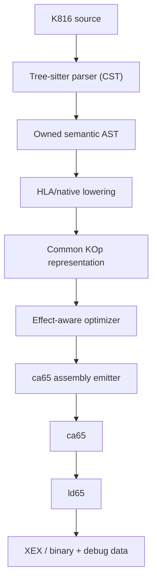

# K816 Rust redesign

This is a plan for redesigning the legacy K816 compiler into a cc65 toolchain member.

## 1. Product boundary

K816 should do exactly four jobs:

1. Understand native and HLA K816 syntax.
2. Diagnose source code.
3. Lower both syntaxes into a common 65816 operation representation and optimize it.
4. Emit ca65 assembly with source/debug annotations.

It should not own:

* machine-code encoding
* object-file formats
* relocation processing
* linking
* memory layout
* executable formats
* a second build system
* a generalized compile-time programming environment

### The instruction set is the documented one

K816 targets the **legal** MOS 6502, WDC 65C02 and WDC 65C816 instruction
sets, and nothing else. Undocumented ("illegal") 6502 encodings are out of
scope: K816 neither assembles them nor offers a way to spell one.

This is a boundary rather than a gap, and it is worth stating because the
original K65 crossed it. K65 has HLA spellings for five of them — `a&.imm`
(ANC), `a?--mem` (DCP), `a-++mem` (ISC), `mem=a&x` (SAX), `x&=a-imm` (AXS) —
and its `* N` cycle-wait spends an odd cycle through `$04`, a three-cycle
`NOP zp` that does not exist in any published instruction set. Every one of
those encodings is a *different, real* instruction on the 65816: `$04` is
`TSB dp`, which reads and writes memory. So the forms cannot be carried over
even in principle, and K816 recognizes each one and refuses it by name rather
than quietly assembling something else. See
[`k65-compat.md`](k65-compat.md).

The pipeline becomes:



The command-line compiler and LSP call the same frontend API. Neither independently reconstructs project semantics.

### The call model has no parameters

One consequence of that boundary is easy to forget and expensive to rediscover, so it is stated here rather than left implicit in the syntax.

K816 does not have function parameters. A `func` is entered by `JSR` or `JSL`, and nothing crosses that jump except the machine's own registers and memory the caller wrote. There is no stack frame, no argument area, and no calling convention the compiler is free to invent — inventing one would mean owning a runtime, which is outside the four jobs above. A call site therefore passes only registers and immediates.

A contract's *inputs* are registers for that reason. Its *outputs* are registers and the four condition flags — `c`, `z`, `n`, `v` — because those cross the jump too: a subroutine that answers a question in the carry is returning a value, and `(a) -> a, c` is how it says so. `i` and `d` are not among them; they are modes the caller establishes before the call, so a callee cannot hand one back.

`inline` is the exception, and it is an exception about *expansion*, not about calling. An inline body is substituted at the use site before instruction selection, so a parameter never has to travel: the compiler can bind an immediate alias (`#factor`) or an identifier alias for a variable or address while it emits the body. Macro expansion is the only mechanism in the language that can inject an arbitrary parameter, which is why aliases exist there and nowhere else.

Read this as a boundary, not a limitation to be fixed later. Adding parameters to `func` would require a compiler-defined runtime convention, which §1 rules out; the available answers are a register, a `var`, or an `inline`.

## 2. Repository structure

Use one Cargo package containing one library and one executable:

```text
k816/
  Cargo.toml
  Cargo.lock
  build.rs

  tree-sitter-k65/
    grammar.js
    tree-sitter.json
    src/
      parser.c
      grammar.json
      node-types.json
    queries/
      highlights.scm
      locals.scm
      tags.scm
      indents.scm
      injections.scm
    test/
      corpus/

  src/
    lib.rs
    main.rs

    source.rs
    diagnostic.rs

    parser/
      mod.rs
      cst.rs
      ast_builder.rs
      diagnostics.rs
    ast.rs

    symbol.rs
    semantic.rs
    lower.rs

    isa.rs
    op.rs
    effects.rs
    optimize.rs

    emit_ca65.rs
    workspace.rs
    lsp.rs

  tests/
    source.rs
    parser.rs
    diagnostics.rs
    semantic.rs
    lowering.rs
    optimizer.rs
    emit_ca65.rs
    compile.rs
    lsp.rs
    golden/
```

`tree-sitter-k65/` is a top-level directory, not a second Cargo package. The
generated parser (`parser.c`) and its metadata are committed and compiled by
`build.rs` during the ordinary Cargo build; grammar regeneration is a
maintainer operation, never part of a normal checkout build.

This does not prohibit modules from being substantial. It prohibits turning every internal boundary into a published crate.

A second package should only be created when there is a real independent consumer or release lifecycle. Initially, there is none.

## 3. Dependencies

Keep the dependency list intentionally boring:

```toml
[dependencies]
ariadne = "..."
clap = { version = "...", features = ["derive"] }
lsp-server = "..."
lsp-types = "..."
serde = { version = "...", features = ["derive"] }
serde_json = "..."
tree-sitter = "..."

[build-dependencies]
cc = "..."
```

Possibly retain `indexmap` for deterministic user-visible ordering.

Do not initially use:

* `chumsky`
* `logos`
* `tokio`
* `tower-lsp`
* `salsa`
* an arena framework
* dependency-injection frameworks
* generalized compiler pass frameworks

None of these are intrinsically bad. They simply do not solve a problem K816 needs to have.

Tree-sitter is the one deliberate parser-generator exception: it is the single
canonical K65/K816 syntax parser shared by the compiler, the LSP, and external
editors (see §5 and `tree-sitter.md`). The runtime dependency is the
`tree-sitter` crate plus `cc` to compile the committed generated parser; the
Tree-sitter CLI and Node.js are needed only when a maintainer regenerates the
grammar.

## 4. Source representation

Use byte-offset spans throughout:

```rust
#[derive(Clone, Copy, Debug, PartialEq, Eq)]
pub struct Span {
    pub file: FileId,
    pub start: u32,
    pub end: u32,
}
```

The `SourceMap` owns source text and translates byte offsets into line/column locations.

Important rules:

* Never preprocess or rewrite source text before parsing.
* Every CST and AST node retains its original byte span.
* Synthetic nodes and operations retain an origin span and are marked synthetic.
* AST nodes own their data. Avoid pervasive lifetime parameters.
* Use interned `SymbolId` values after parsing, but plain strings in early syntax nodes are acceptable.

The recent span-preservation correction in K816 demonstrates why this must be foundational rather than repaired downstream.

## 5. Parser

Use Tree-sitter as the single canonical parser (see `tree-sitter.md`). The
grammar lives in `tree-sitter-k65/`; the generated C parser is committed and
compiled into the compiler by `build.rs`. The same grammar and query files
serve the CLI, the LSP, and external editors, so no tool ever implements a
second syntax.

Tree-sitter provides what the earlier handwritten-parser proposal wanted, plus
incremental parsing for the LSP:

* stable CSTs for incomplete code during editing
* built-in error recovery (`ERROR`/`MISSING` nodes)
* exact byte spans
* incremental reparse for responsive editor operations
* one grammar shared by compiler, LSP, and editor highlighting/navigation

Tree-sitter stops at the syntax boundary. A small adapter (`src/parser/`)
wraps it behind a Rust API and converts the CST into the owned semantic AST:

```rust
pub struct SyntaxTree {
    tree: tree_sitter::Tree,
}

pub fn parse_source(
    source: &SourceFile,
    previous: Option<&SyntaxTree>,
) -> ParseResult;

pub struct ParseResult {
    pub tree: SyntaxTree,
    pub file: AstFile,
    pub diagnostics: Vec<Diagnostic>,
}
```

Rules for the boundary:

* `TSNode` and other Tree-sitter runtime types never cross into semantic
  analysis, lowering, optimization, or emission; node-name matching is
  localized in the CST-to-AST builder.
* Malformed constructs become owned `AstKind::Error` nodes, so LSP completion,
  document symbols, and later diagnostics continue functioning after the first
  syntax error.
* A syntax-diagnostic adapter maps common `ERROR`/`MISSING` shapes to stable,
  actionable diagnostics and fixes; Tree-sitter supplies reliable ranges, K816
  supplies the explanation and remediation.
* Known-but-unsupported K65 syntax is recognized by the grammar as specific
  named nodes; `ERROR` is reserved for genuinely malformed source.

`tree-sitter.md` also sketches a C compiler core (`libk816`) with a Rust FFI
host. That packaging does not apply to this Rust redesign; what carries over
is the architectural rule that Tree-sitter is the canonical parser at the
syntax boundary and no editor or tool implements a second semantic compiler.

## 6. AST and syntax parity

Native assembly and HLA statements should remain distinct in the syntax AST:

```rust
pub enum Statement {
    Native(NativeInstruction),
    Hla(HlaStatement),
    Label(Label),
    Directive(Directive),
    Block(Block),
    Error,
}
```

This preserves the user’s notation and supports formatting, hover, navigation, and precise diagnostics.

They then converge during lowering:

```rust
match statement {
    Statement::Native(inst) => lower_native(inst, context),
    Statement::Hla(stmt)    => lower_hla(stmt, context),
    // ...
}
```

For example:

```k816
lda player.x
```

and:

```k816
a = player.x
```

should lower to the same `KOp::Instruction` value. After that point, the optimizer and emitter must not care which syntax produced it.

That is the concrete meaning of native/HLA parity: HLA is transparent shorthand for the same assembly-shaped semantic operations.

## 7. Common operation representation

Keep this representation close to 65816 assembly:

```rust
pub struct Op {
    pub kind: OpKind,
    pub span: Span,
    pub origin: Origin,
}

pub enum Origin {
    User,
    HlaExpansion,
    CompilerGenerated,
}

pub enum OpKind {
    Instruction(Instruction),
    Label(SymbolId),
    Segment(SymbolId),
    Data(DataOp),
    Align(Expression),
    Export(SymbolId),
    Import(SymbolId),
    ModeAssumption(ModeState),
}
```

An instruction should be strongly typed:

```rust
pub struct Instruction {
    pub mnemonic: Mnemonic,
    pub operand: Option<Operand>,
}

pub enum Operand {
    Immediate(Expression),
    Address(AddressOperand),
    Label(SymbolId),
    Indirect(IndirectOperand),
    StackRelative(Expression),
}
```

Do not represent validated mnemonics and addressing modes as strings. An enum match should fail to compile when a new instruction or mode is not handled.

At the same time, do not create a generic SSA compiler IR. K816 is a transparent assembly translator, not LLVM.

## 8. Effect-aware optimizer

This is the architectural heart of K816 and should be retained.

Every instruction has a conservative effect description:

```rust
pub struct Effects {
    pub reads: CpuState,
    pub writes: CpuState,
    pub memory: MemoryEffect,
    pub control: ControlEffect,
    pub width: WidthEffect,
}
```

`width` is not derivable from `writes`. A `FlagSet` says only that M or X was
*written*, so `SEP` and `SEP`'s opposite are indistinguishable through it,
while every assembler width directive and every width-dependent immediate needs
to know which way. It is the fifth field for that reason.

`CpuState` includes:

* A, X, Y
* S, D, DBR, PBR
* N, V, M, X, D, I, Z, C, E

Memory effects distinguish at least:

* none
* read
* write
* read/write
* stack
* volatile or unknown

`Volatile` is declared and produced by nothing, and that is deliberate: K65 has
no `volatile` and no way to acquire one — a fixed-address `var` *is* how the
language spells a hardware register. The optimizer answers the question the
variant would have answered by never coalescing a memory read at all, so two
reads of one address are two reads. Giving the variant a producer needs a
language surface first.

Effects should be derived from the instruction table, not copied into every `Op`, so they cannot silently become stale.

Optimization should be conservative:

* Labels are merge points, not barriers: control may *arrive* at one, which the block graph's successor relation expresses. A branch target the compiler cannot name is what makes every label in a function reachable from a state nothing established.
* Calls and unknown operations clobber conservatively. A call returns — `JSR` is not a leaf of the graph — while remaining a dataflow barrier: the callee may read any register and any flag, including ones no contract names.
* Memory-mapped I/O writes are always visible.
* Stack operations are visible.
* Flag writes are visible whenever a later operation reads those flags.
* Width-changing operations participate in the same state model, and they redefine what a register write *covers*: at eight bits an `LDA` writes the low byte and leaves the accumulator's hidden high byte alone, and a narrowing `SEP` zeroes the high bytes of X and Y while preserving the low ones. Both are partial writes the effect model records as whole ones, so the registers a width transition resizes are live across it.
* Nothing is dead where a function returns. Every register and every flag is live at every exit, on every function, whatever its `->` clause says. **The reason is not the escape hatch.** A contract can name a flag, and an output a clause does not list is undefined after the call at *every* call site, `call foo` included; `call foo` opts out of the `K816-W0123` check, not out of the language rule, so a caller that reads outside the clause is reading undefined state and an optimizer would be entitled to break it. What is not licensed is a function control **enters without calling**: a tail `goto` into a section makes that section's `rts` return to the *jumping* function's caller, which was compiled against a different clause, so the section's own clause is not the contract its return has to satisfy. Narrowing needs a rule for that case before it needs anything else.
* And what it would buy is measured, not assumed. Over `examples/`, the golden fixtures and the imported corpus, seeding each declaring function's exit with its clause would let the optimizer delete **three instructions, six bytes**. Five of 251 emitted sections declare an output at all — an `inline` is not one of them, having no exit to seed — so most of the corpus cannot be narrowed by any rule. The compiler records what each function declares, in `FunctionInfo::declared_outputs`; no pass reads it, and `tests/live_outs.rs` re-derives both numbers whenever the corpus moves. **That decision now has a measurement behind it.** Over `examples/`, the golden fixtures and the imported corpus - 256 functions and 72 call sites - narrowing the seed to what each clause declares would let the optimizer delete three instructions, six bytes in all. Ten of the 256 functions declare an output; twelve of the 72 call sites state the flow they expect, and the other sixty reach their callee through `call foo`, a bare name, or a hand-written `jsr`, none of which checks a clause against anything. So the escape hatch is not a corner case to be argued away, and what narrowing would buy is smaller than the rule it would need.
* User-written native instructions and HLA-generated instructions receive identical treatment after lowering.

The optimizer can remain a fixed sequence of small, understandable passes:

```rust
pub fn optimize(program: &mut Program) {
    remove_overwritten_register_values(program);
    coalesce_known_register_loads(program);
    eliminate_redundant_mode_changes(program);
    rewrite_zero_store(program);
    collapse_repeated_flag_operations(program);
    rewrite_tail_calls(program);
    remove_unreachable_generated_ops(program);
    remove_branches_to_the_next_label(program);
    collapse_duplicate_returns(program);
}
```

**`rewrite_tail_calls` rewrites nothing, and that is a decision rather than a
gap.** `implementation.md` phase 9 asks for *safe* tail calls, and the safe set
K816 can identify is empty. Turning `jsr f` + `rts` into `jmp f` leaves `f`
running with the stack two bytes shallower and with a live slot holding the
caller's own return address, and licensing the rewrite needs a fact the
compiler cannot have — that `f` never reads that slot. Opcode checks close only
the routes that name `S`, because the stack is ordinary bank-zero memory and
`lda $01FE` reaches the frame without it; alias analysis would have to refuse
every callee that reads memory through anything but a compile-time-known
non-stack address, which is close to refusing every callee for a rewrite worth
one byte. `tests/golden/opt-barriers.k816` carries a `jsr`/`rts` pair asserting
that nothing happens to it.

Three things would unlock it, and each is a language decision rather than an
optimizer one: an explicit stack-transparency declaration a function carries;
the ABI rule that stack memory belongs to the implementation and a function may
read only its own frame; or a whole-program proof about every reader of stack
memory, which is out of reach while units compile separately.

The sequence above is a *reading* order. **The runtime order is the one
`implementation.md` phase 9 fixes**, which wins over this document (§2 of the
master plan), and it runs the mode passes first so that folding sees single-bit
masks fresh from lowering. One entry is missing from both lists: after every
byte-removing pass — passes 9 and 10 included — a branch the lowering stage
emitted in its long form because it could not prove the short one reached may
now reach, and putting it back is the last pass of all.

Each pass should operate on local basic blocks. The blocks need a complete
successor relation — otherwise everything after the first `JSR` looks
unreachable — but not a framework: one shared view and one backward dataflow
per function, built where the passes are.

The current [peephole optimizer](https://github.com/X65/K816/blob/main/crates/core/src/peephole.rs) already contains valuable behavior. Port the rules and their tests, but rebuild them on one complete effect model rather than carrying over all implementation details.

**What the port took and what it declined.** Its eight rules map onto this
list as follows. `coalesce_repeated_immediate_loads`,
`remove_dead_adjacent_register_writes`, `stz_rewrite` and
`collapse_duplicate_flag_ops` are the load, dead-write, zero-store and flag
passes above, rebuilt on the effect table rather than on mnemonic lists.
`prune_unreachable_instructions` is the unreachable pass, **without its
warnings**: it warned once per dropped instruction, and `emit-ir --after-opt
--explain` answers the same question on demand and only when asked.
`rewrite_tail_calls` rewrites nothing, for the reason above.
`remove_branch_to_next_label` and `collapse_duplicate_returns` are passes 9
and 10, and each changed shape on the way:

* The branch pass restricts by the **branch's** origin rather than by its
  target. The legacy rule removed a branch only to a label its own lowering
  had synthesized, which in that compiler was the same set as "labels a
  compiler-emitted branch can name". It is not the same set here — `> goto
  done` expands to `bcs done`, naming a label the user wrote — so the
  restriction moved to who wrote the branch. A hand-written `jmp` to the next
  line stays, which is the rule the unreachable pass already follows.
* It iterates. One removal exposes another: the guard of a `>` expansion is
  separated from its landing site only by the branch the pass has just taken
  away, and the legacy's single scan found the outer one and stopped.
* The duplicate-return pass is **the one pass that removes a user-written
  operation**, and its justification is structural rather than an origin
  check: a return has no successors, so the only way to reach a second one is
  to arrive from outside, and the only thing that lets an edge in is a label.
  Any operation at all between the two ends the run.

Both remove bytes, so both run **before** branch shrinking rather than after
it: shrinking measures distances, and a distance taken before those bytes are
gone is a branch left in its long form for no reason.

## 9. Diagnostics as an internal protocol

Diagnostics should be structured data, never pre-rendered strings:

```rust
pub struct Diagnostic {
    pub code: DiagnosticCode,
    pub severity: Severity,
    pub title: String,
    pub primary: Label,
    pub secondary: Vec<Label>,
    pub notes: Vec<String>,
    pub help: Option<String>,
    pub fixes: Vec<Fix>,
    pub docs: Option<DocsRef>,
}
```

A fix is a real edit:

```rust
pub struct Fix {
    pub title: String,
    pub applicability: Applicability,
    pub edits: Vec<TextEdit>,
}
```

Then provide two renderers:

* CLI renderer using Ariadne
* LSP conversion producing diagnostics and code actions

This ensures the CLI and editor cannot disagree about what an error means.

Every important diagnostic should contain:

* a stable code, such as `K816-E0123`
* a concise explanation
* a meaningful primary label
* exact remediation
* secondary spans where relationships are involved
* a machine-applicable edit where safe
* a documentation key or URL

The rich-diagnostic rules already documented in [AGENTS.md](https://github.com/X65/K816/blob/main/AGENTS.md) are worth keeping almost intact. The redesign should make them easier to implement instead of reconstructing context after parser failure.

## 10. LSP architecture

Keep `lsp-server` and `lsp-types`. They already provide the transport and protocol types without requiring async Rust.

```text
stdio loop
  -> document store (source text + incremental Tree-sitter trees)
  -> compiler database
  -> shared parse/analyze API
  -> LSP response conversion
```

Start synchronously. Incremental Tree-sitter trees keep typing and syntax
operations responsive; a K816 source tree is small enough to reanalyze
semantically after a short debounce.

Initial LSP milestone:

* live syntax and semantic diagnostics
* code actions from compiler fixups
* hover for symbols, instructions, and inferred widths
* go to definition
* references and rename
* completion
* document symbols
* formatting

Avoid building an incremental query engine until profiling proves whole-unit analysis is too slow.

The important rule is that LSP never runs an approximate compiler. It calls the exact same functions as the CLI:

```rust
pub fn analyze_workspace(
    sources: &[SourceFile],
    options: &Options,
) -> Analysis;
```

The CLI may continue to ca65 after successful analysis. The LSP stops at `Analysis`.

## 11. ca65 and ld65 integration

K816 produces readable `.s` files:

```text
program.k816 -> program.s -> program.o -> program.xex
```

The emitted assembly should:

* preserve recognizable native instructions
* include comments showing HLA expansion where useful
* emit cc65-compatible source/debug annotations
* retain K816 file and line ownership on each generated operation
* use ca65 imports, exports, segments, relocations, and expressions
* avoid resolving addresses that belong to ld65

With debug annotations enabled, ca65/ld65 generate the debug database consumed by `cc65-dbg`.

Integration with the cc65 toolchain should happen in two stages:

1. Make `k816 compile file.k816 -o file.s` stable.
2. Teach the cc65 driver to recognize `.k816`, invoke the K816 frontend, and feed the resulting assembly to ca65.

K816 can be distributed alongside cc65 without being rewritten into the cc65 C codebase. “Part of the cc65 toolchain” should mean one installation and one driver experience, not necessarily one implementation language.

## 12. Golden tests

Keep the current golden suite. Treat it as the language compatibility corpus, not as unquestionable truth.

Organize testing into layers:

| Layer       | Assertion                                          |
| ----------- | -------------------------------------------------- |
| Grammar     | corpus acceptance and exact CST shapes             |
| Incremental | incremental edit equals clean reparse              |
| Parser      | owned AST, exact spans, and recovered errors       |
| Semantics   | symbols, widths, contracts, operand classification |
| Lowering    | native and HLA produce equivalent `KOp` sequences  |
| Optimizer   | before/after operation streams                     |
| Diagnostics | complete rendered messages and structured fixes    |
| Emitter     | exact ca65 assembly                                |
| End-to-end  | linked bytes match expected binaries               |
| LSP         | protocol requests return compiler-derived results  |

During migration, run both compilers:

```text
fixture
  -> old K816 -> expected binary
  -> new K816 -> ca65/ld65 -> candidate binary
  -> compare
```

Do not bulk-bless differences. Classify each difference as:

* new compiler defect
* old compiler defect
* backend representation difference with identical behavior
* intentional language change

## 13. Migration plan

### Milestone 0: Freeze the contract

* Tag the current compiler.
* Preserve every existing golden fixture.
* Categorize fixtures by syntax feature.
* Stop adding architectural features to the old compiler.
* Allow only critical correctness fixes.

### Milestone 1: Native translator

Implement:

* sources and spans
* diagnostics
* Tree-sitter grammar for native syntax
* CST-to-AST parser adapter
* symbols and expressions
* common `KOp`
* ca65 emission
* `.dbg` source annotations
* minimal LSP diagnostics

Success criterion: representative native K816 files assemble and debug through ca65/ld65.

### Milestone 2: HLA core

Implement:

* register assignment syntax
* expressions and transfers
* structured conditionals and loops
* function contracts
* HLA-to-`KOp` lowering
* native/HLA equivalence tests

Success criterion: each HLA construct has an obvious expected `KOp` sequence and exact emitted assembly.

### Milestone 3: Semantic optimizer

Implement:

* complete register and flag effects
* width-state tracking
* basic-block barriers
* dead-operation elimination
* existing peephole rewrites
* optimization explanation dumps

Add:

```bash
k816 emit-ir file.k816
k816 emit-ir --after-opt file.k816
k816 compile --no-opt file.k816
```

The explanation dump is `emit-ir --after-opt --explain`, and it is the reason
the optimizer reports no diagnostic of its own: a warning for a *correct*
rewrite would be noise on every build, and "where did my instruction go" is a
question to ask on demand. It prints the pass, the position, what the operation
became, and the justification the pass recorded — the same text the pass tests
assert on, so the explanation and the test cannot disagree.

These commands are important for trusting the compiler.

### Milestone 4: Language compatibility

Migrate remaining golden groups individually:

* declarations and symbolic subscripts
* data blocks
* compile-time expressions
* inline/far functions
* multi-file symbols
* asset directives that remain in language scope
* diagnostics and fixups

Features that do not justify their complexity can be explicitly removed rather than silently omitted.

### Milestone 5: Toolchain integration

* cc65 driver recognizes `.k816`
* ca65 and ld65 invocation is standardized
* cc65-dbg receives correct source mappings
* VS Code extension switches to the new LSP
* OS/816 builds through the new path

### Milestone 6: Retirement

Only after OS/816 and the compatibility corpus pass:

* archive the custom O65 backend
* archive the custom linker
* remove obsolete workspace crates
* make the new compiler the default K816

## 14. Non-negotiable design rules

I would put these at the top of the new repository:

1. One semantic compiler implementation serves CLI and LSP.
2. Native and HLA syntax converge before optimization.
3. Every operation has a source origin.
4. Every optimization is justified by explicit CPU effects.
5. Unknown effects prevent optimization.
6. Diagnostics are structured data with remediation.
7. ca65 owns encoding and relocation.
8. ld65 owns layout and linking.
9. No new abstraction without two concrete users.
10. No new crate without an independent release boundary.
11. No async runtime without measured need.
12. Golden outputs are reviewed, never blindly blessed.
13. Tree-sitter is the single canonical parser for CLI, LSP, and editors.
14. Tree-sitter runtime types never cross the syntax boundary into semantics.

## Recommended first deliverable

The first new version should compile only a deliberately small but complete slice:

```k816
func main @a8 {
    a = #0
    a = #1
    SCREEN = a
    return
}
```

(The annotation restates what the entry ABI provides. `main`'s caller is the
environment, so an annotation on it is a claim about that environment rather
than a request K816 satisfies with entry setup — see
`register-width-aware-syntax.md`, "The entry point".)

It should demonstrate all defining qualities at once:

* parsed HLA
* semantic register-width checking
* lowering to assembly-shaped `KOp`
* removal of the dead `a = #0`
* ca65 output
* original source-line debug mapping
* rich real-time LSP diagnostics
* an end-to-end linked X65 program

That vertical slice is a better foundation than first recreating all twelve current crates. It proves the soul of K816: transparent high-level 65816 programming with modern compiler guidance.

