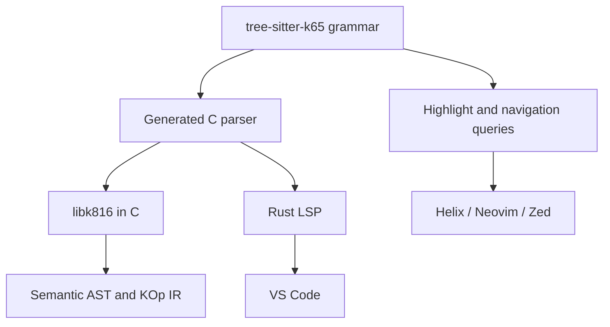

Tree-sitter should become the single canonical parser for K65/K816. That removes the need to build and maintain a separate incremental parser for the LSP.

One correction: Tree-sitter largely solves parsing and syntax highlighting, but not the entire LSP. Name resolution, type/mode checking, completion, hover, references, and rich diagnostics still come from K816’s semantic frontend.

## Recommended architecture



### 1. Separate `tree-sitter-k65` grammar

Create a small standalone repository or top-level directory:

```text
tree-sitter-k65/
├── grammar.js
├── tree-sitter.json
├── src/
│   ├── parser.c
│   ├── grammar.json
│   └── node-types.json
├── queries/
│   ├── highlights.scm
│   ├── locals.scm
│   ├── tags.scm
│   ├── indents.scm
│   └── injections.scm
├── bindings/
│   ├── c/
│   └── rust/
└── test/
    └── corpus/
```

Tree-sitter grammars are written declaratively and generate a C parser. The same generated parser can be consumed through both the native C API and official Rust bindings. The C compiler therefore does not acquire a Rust dependency. [Tree-sitter’s parsing runtime has a native C API](https://tree-sitter.github.io/tree-sitter/using-parsers/), and a generated parser can be embedded directly alongside the runtime’s `lib.c`. [Official build instructions](https://tree-sitter.github.io/tree-sitter/using-parsers/1-getting-started.html)

The Rust toolchain is only needed while developing or regenerating the grammar. Generated `parser.c` should be committed.

### 2. Tree-sitter produces a CST, not the semantic AST

The compiler pipeline becomes:

```text
source
  -> Tree-sitter CST
  -> CST validation
  -> semantic AST
  -> name/mode analysis
  -> common KOp IR
  -> peephole optimizer
  -> ca65 source
```

Keep the semantic AST and KOp IR we already decided upon. Do not try to use `TSNode` as the compiler’s internal representation.

The CST preserves syntax details:

```text
(hla_assignment
    destination: (register)
    operator: "="
    value: (expression))
```

The AST contains resolved meaning:

```c
KExpr {
    .kind = KEXPR_ASSIGN,
    .assign.destination = KREG_A,
    .assign.value = ...
}
```

Then both native and HLA nodes lower into the same KOp representation.

Tree-sitter deliberately creates a concrete syntax tree closely matching recognizable language constructs, which is exactly what we need for preserving the relationship between HLA syntax and emitted assembly. [Grammar design guidance](https://tree-sitter.github.io/tree-sitter/creating-parsers/3-writing-the-grammar.html)

### 3. Make original K65 syntax part of the grammar immediately

The grammar should recognize the entire known K65 syntax namespace, including features K816 cannot compile yet.

For example:

```javascript
statement: $ => choice(
    $.label,
    $.native_instruction,
    $.hla_statement,
    $.directive,
    $.unsupported_k65_statement
)
```

An unimplemented K65 construct must produce a valid, named CST node:

```text
(unsupported_k65_statement ...)
```

It must not become an anonymous `ERROR` node. This lets the semantic frontend emit:

```text
error[K816-K65-0041]: this original K65 construct is not implemented yet
```

`ERROR` and `MISSING` Tree-sitter nodes should be reserved for genuinely malformed source.

This is how we prevent future K816 additions from accidentally consuming original K65 syntax.

## Rust LSP

I would retain Rust only as a thin LSP host:

```text
k816-lsp/
├── JSON-RPC/LSP transport
├── document text storage
├── Tree-sitter incremental trees
├── workspace symbol index
└── FFI binding to libk816
```

It should not contain a second implementation of K816 semantics.

The division is:

| Responsibility               | Owner                                          |
| ---------------------------- | ---------------------------------------------- |
| Incremental document parsing | Tree-sitter Rust binding                       |
| Syntax node at cursor        | Tree-sitter                                    |
| Syntax errors                | Tree-sitter diagnostic adapter                 |
| Symbols and scopes           | `libk816`                                      |
| Register-width analysis      | `libk816`                                      |
| Optimizer diagnostics        | `libk816`                                      |
| Completion candidates        | LSP using semantic scope data                  |
| Hover information            | LSP using AST/symbol data                      |
| Definition and references    | Workspace symbol index                         |
| Formatting                   | CST-based formatter                            |
| Rename                       | Semantic references, never textual replacement |

The LSP can reparse an entire file semantically after each edit. K65 files are small, so sophisticated incremental semantic analysis would be needless complexity. Tree-sitter keeps typing and syntax operations responsive; after a short debounce, the C frontend performs complete semantic analysis.

A simple API boundary would suffice:

```c
typedef struct K816Analysis K816Analysis;

K816Analysis *k816_analyze(
    const char *path,
    const char *source,
    size_t source_size,
    const K816Options *options
);

const K816Diagnostic *k816_analysis_diagnostics(
    const K816Analysis *analysis,
    size_t *count
);

const K816Symbol *k816_analysis_symbols(
    const K816Analysis *analysis,
    size_t *count
);

void k816_analysis_destroy(K816Analysis *analysis);
```

Later, completion and hover can receive source offsets:

```c
K816CompletionList k816_complete(
    const K816Analysis *analysis,
    uint32_t byte_offset
);

K816Hover k816_hover(
    const K816Analysis *analysis,
    uint32_t byte_offset
);
```

This keeps Rust out of the compiler while making the LSP pleasant to implement.

## Diagnostics caveat

Tree-sitter tells us that parsing failed through `ERROR` and `MISSING` nodes, but it does not automatically produce clang-quality explanations.

We still need a diagnostic adapter that translates common malformed CST shapes:

```text
ERROR after `if`
```

into:

```text
error[K816-E0123]: expected a condition after `if`
  --> main.k65:14:8
   |
14 |     if {
   |        ^ condition missing

help: write `if <expression> {`
```

Semantic diagnostics remain completely under our control. Tree-sitter provides reliable ranges; K816 supplies the explanation, documentation link, and fixup.

## Syntax highlighting caveat

For Helix, Neovim, and Zed, `queries/highlights.scm` is essentially the solution. Tree-sitter highlighting is defined through query captures over syntax nodes. [Official highlighting documentation](https://tree-sitter.github.io/tree-sitter/3-syntax-highlighting.html)

For VS Code, Tree-sitter queries are not consumed automatically. The K816 extension should provide:

* A small TextMate grammar for immediate lexical highlighting.
* LSP semantic tokens f     or accurate symbol-aware highlighting.
* Tree-sitter inside the language server for syntax understanding.

The TextMate grammar can remain deliberately shallow because the semantic token provider corrects identifiers, registers, labels, types, functions, constants, and directives once the LSP responds.

## Practical implementation order

1. Build `tree-sitter-k65` using the existing golden files as grammar corpus tests.
2. Add original K65 examples and reserve all known syntax.
3. Write `highlights.scm` and test it in Helix first.
4. Replace the new C compiler’s planned parser with CST-to-AST lowering.
5. Expose semantic analysis from `libk816`.
6. Replace the current LSP internals with a thin Rust Tree-sitter host.
7. Add semantic tokens and a minimal TextMate grammar to the VS Code extension.
8. Add formatting, navigation, rename, and completion incrementally.

This is a good compromise: the actual compiler stays small and pure C, while the surviving Rust component is a conventional LSP adapter rather than another elaborate compiler architecture.
