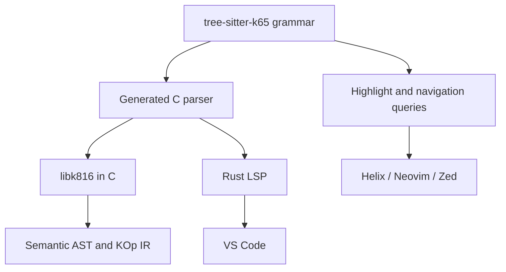

Tree-sitter should become the single canonical parser for K65/K816. That removes the need to build and maintain a separate incremental parser for the LSP.

One correction: Tree-sitter largely solves parsing and syntax highlighting, but not the entire LSP. Name resolution, type/mode checking, completion, hover, references, and rich diagnostics still come from K816’s semantic frontend.

## Recommended architecture



### 1. Separate `tree-sitter-k65` grammar

Create a small standalone repository or top-level directory:

```text
tree-sitter-k65/
├── grammar.js
├── tree-sitter.json
├── src/
│   ├── parser.c
│   ├── scanner.c
│   ├── grammar.json
│   └── node-types.json
├── queries/
│   ├── highlights.scm
│   ├── locals.scm
│   ├── tags.scm
│   ├── indents.scm
│   └── injections.scm
├── bindings/
│   ├── c/
│   └── rust/
└── test/
    └── corpus/
```

Tree-sitter grammars are written declaratively and generate a C parser. The same generated parser can be consumed through both the native C API and official Rust bindings. The C compiler therefore does not acquire a Rust dependency. [Tree-sitter’s parsing runtime has a native C API](https://tree-sitter.github.io/tree-sitter/using-parsers/), and a generated parser can be embedded directly alongside the runtime’s `lib.c`. [Official build instructions](https://tree-sitter.github.io/tree-sitter/using-parsers/1-getting-started.html)

The Rust toolchain is only needed while developing or regenerating the grammar. Generated `parser.c` should be committed. `scanner.c` is the one hand-written C file: it produces a zero-width token at a line break after a raw mnemonic or its operand, because a mnemonic may stand alone and the next line may be a bare call, and whether a line ended is the one thing a grammar whose extras include every newline cannot see.

`generated.lock` records a hash of each generated file, and `cargo test` fails when the committed files and the lock disagree. The Zed extension in `editors/zed-k816/` pins the grammar by commit, and a second gate holds the pinned commit to the same lock, so the parser Zed compiles is the one the server runs. A commit cannot name its own hash, so **a grammar regeneration is two commits**: regenerate and refresh the lock, then move the extension's `rev` to that commit. The first is red on the pin gate until the second lands, and the two are pushed together.

### 2. Tree-sitter produces a CST, not the semantic AST

The compiler pipeline becomes:

```text
source
  -> Tree-sitter CST
  -> CST validation
  -> semantic AST
  -> name/mode analysis
  -> common KOp IR
  -> peephole optimizer
  -> ca65 source
```

Keep the semantic AST and KOp IR we already decided upon. Do not try to use `TSNode` as the compiler’s internal representation.

The CST preserves syntax details:

```text
(hla_assignment
    destination: (register)
    operator: "="
    value: (expression))
```

The AST contains resolved meaning:

```c
KExpr {
    .kind = KEXPR_ASSIGN,
    .assign.destination = KREG_A,
    .assign.value = ...
}
```

Then both native and HLA nodes lower into the same KOp representation.

Tree-sitter deliberately creates a concrete syntax tree closely matching recognizable language constructs, which is exactly what we need for preserving the relationship between HLA syntax and emitted assembly. [Grammar design guidance](https://tree-sitter.github.io/tree-sitter/creating-parsers/3-writing-the-grammar.html)

### 3. Make original K65 syntax part of the grammar immediately

The grammar should recognize the entire known K65 syntax namespace, including features K816 cannot compile yet.

For example:

```javascript
statement: $ => choice(
    $.label,
    $.native_instruction,
    $.hla_statement,
    $.directive,
    $.unsupported_k65_statement
)
```

A K65 construct K816 does not compile must produce a valid, named CST node:

```text
(reserved_image_block ...)
```

It must not become an anonymous `ERROR` node. This lets the semantic frontend
name the construct rather than the character it choked on:

```text
error[K816-K65-0001]: K65 `image` is not a K816 construct
```

`ERROR` and `MISSING` Tree-sitter nodes should be reserved for genuinely malformed source.

This is how we prevent future K816 additions from accidentally consuming original K65 syntax.

## Rust LSP

I would retain Rust only as a thin LSP host:

```text
k816-lsp/
├── JSON-RPC/LSP transport
├── document text storage
├── Tree-sitter incremental trees
├── workspace symbol index
└── FFI binding to libk816
```

It should not contain a second implementation of K816 semantics.

The division is:

| Responsibility               | Owner                                          |
| ---------------------------- | ---------------------------------------------- |
| Incremental document parsing | Tree-sitter Rust binding                       |
| Syntax node at cursor        | Tree-sitter                                    |
| Syntax errors                | Tree-sitter diagnostic adapter                 |
| Symbols and scopes           | `libk816`                                      |
| Register-width analysis      | `libk816`                                      |
| Optimizer diagnostics        | `libk816`                                      |
| Completion candidates        | LSP using semantic scope data                  |
| Hover information            | LSP using AST/symbol data                      |
| Definition and references    | Workspace symbol index                         |
| Formatting                   | CST-based formatter                            |
| Rename                       | Semantic references, never textual replacement |

The LSP can reparse an entire file semantically after each edit. K65 files are small, so sophisticated incremental semantic analysis would be needless complexity. Tree-sitter keeps typing and syntax operations responsive; after a short debounce, the C frontend performs complete semantic analysis.

A simple API boundary would suffice:

```c
typedef struct K816Analysis K816Analysis;

K816Analysis *k816_analyze(
    const char *path,
    const char *source,
    size_t source_size,
    const K816Options *options
);

const K816Diagnostic *k816_analysis_diagnostics(
    const K816Analysis *analysis,
    size_t *count
);

const K816Symbol *k816_analysis_symbols(
    const K816Analysis *analysis,
    size_t *count
);

void k816_analysis_destroy(K816Analysis *analysis);
```

Later, completion and hover can receive source offsets:

```c
K816CompletionList k816_complete(
    const K816Analysis *analysis,
    uint32_t byte_offset
);

K816Hover k816_hover(
    const K816Analysis *analysis,
    uint32_t byte_offset
);
```

This keeps Rust out of the compiler while making the LSP pleasant to implement.

## Diagnostics caveat

Tree-sitter tells us that parsing failed through `ERROR` and `MISSING` nodes, but it does not automatically produce clang-quality explanations.

We still need a diagnostic adapter that translates common malformed CST shapes:

```text
ERROR after `if`
```

into:

```text
error[K816-E0123]: expected a condition after `if`
  --> main.k65:14:8
   |
14 |     if {
   |        ^ condition missing

help: write `if <expression> {`
```

Semantic diagnostics remain completely under our control. Tree-sitter provides reliable ranges; K816 supplies the explanation, documentation link, and fixup.

## Syntax highlighting: two formats, and the second is derived from the first

**Amended.** This section proposed a TextMate grammar beside semantic tokens.
`implementation.md` §3 decision 12 was amended on 2026-09-01 to refuse the
TextMate half, and what is implemented is what follows
(`plans/07-lsp-tooling.md` decision 15).

There are two formats and no third:

* **`queries/highlights.scm`**, which Zed, Helix and Neovim can read
  directly. Tree-sitter highlighting is defined through query captures over
  syntax nodes. [Official highlighting documentation](https://tree-sitter.github.io/tree-sitter/3-syntax-highlighting.html)
  The Zed extension in `editors/zed-k816/` reads a copy, because Zed reads
  queries only from an extension's own directory, and `tests/zed.rs` holds
  the copy to this file byte for byte.
* **`textDocument/semanticTokens`**, for editors that do not read
  Tree-sitter queries — VS Code among them. The server answers it by running
  *that same file* over the document's tree and mapping each capture onto the
  token legend, then refining the captures the grammar could not decide —
  a bare identifier — through the symbol table.

**No TextMate grammar is written or shipped**, by the server or by any
extension. A TextMate grammar is a second description of the same
highlighting, written in a second language, and it drifts: the case the
amendment turns on is that a shallow grammar is shallow *differently* from
the query, so the two disagree on exactly the constructs a reader is unsure
about. The semantic tokens are not a workaround for the missing TextMate
grammar; they are the same description delivered in the other format, which
is why `highlights.scm` is compiled into the server binary and run rather
than transcribed.

What keeps them one description is a pair of gates in `tests/queries.rs`: a
capture name the token legend does not map is a failure, and a legend entry
the query never produces is a failure too. The legend and the query's capture
set are the same closed set.

**Still declined**: inlay hints, code lens, folding ranges, and signature
help. The legacy server offered all four; phase 11 lists none of them, and
their absence is a decision rather than an omission
(`plans/07-lsp-tooling.md` decision 6).

## Practical implementation order

1. Build `tree-sitter-k65` using the existing golden files as grammar corpus tests.
2. Add original K65 examples and reserve all known syntax.
3. Write `highlights.scm` and test it in Helix first.
4. Replace the new C compiler’s planned parser with CST-to-AST lowering.
5. Expose semantic analysis from `libk816`.
6. Replace the current LSP internals with a thin Rust Tree-sitter host.
7. Add semantic tokens and a minimal TextMate grammar to the VS Code extension.
8. Add formatting, navigation, rename, and completion incrementally.

This is a good compromise: the actual compiler stays small and pure C, while the surviving Rust component is a conventional LSP adapter rather than another elaborate compiler architecture.
